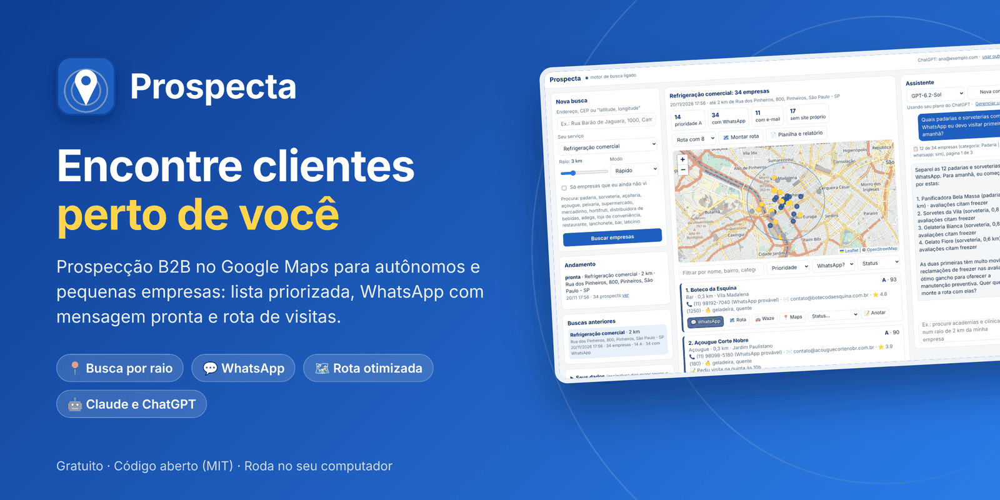
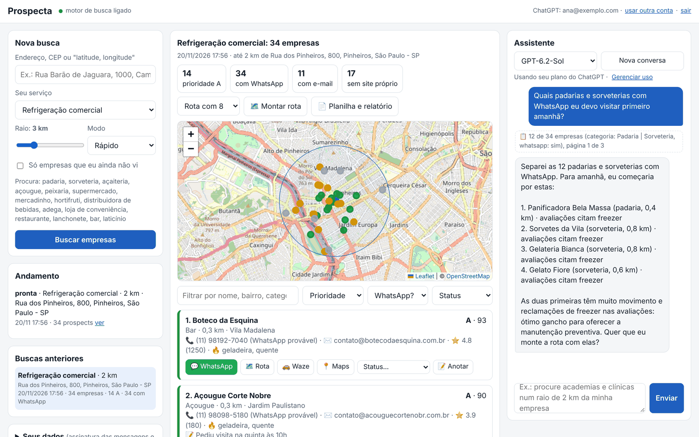
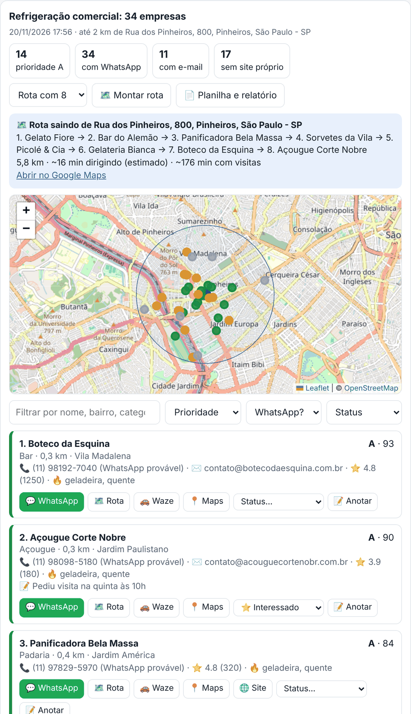
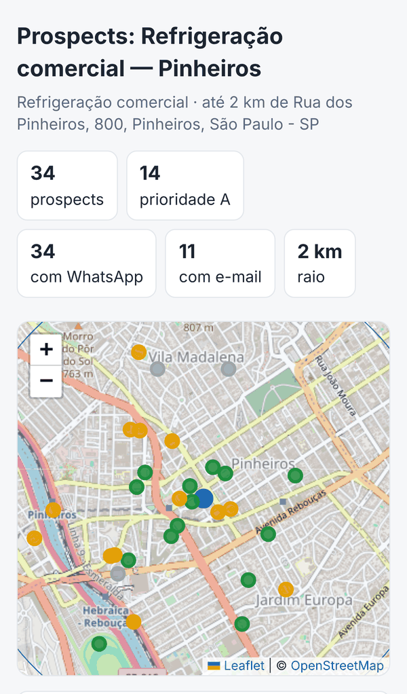
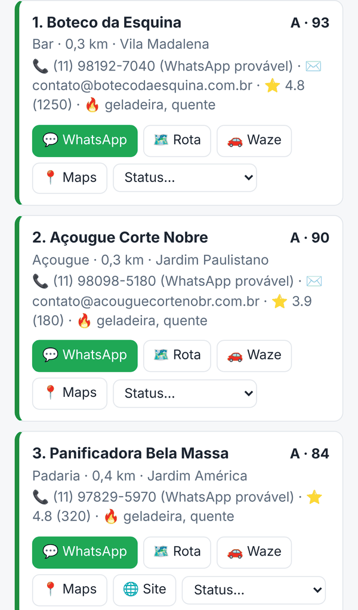

<p align="center">
  
</p>

<h1 align="center">📍 Prospecta</h1>

<h3 align="center">Encontre clientes para o seu serviço perto de você<br>Prospecção B2B no Google Maps, com WhatsApp, rota de visitas e IA</h3>

<p align="center">
  <a href="https://github.com/RodrigoFlorencio86/prospecta/releases/latest"></a>
  <a href="https://github.com/RodrigoFlorencio86/prospecta/actions/workflows/testes.yml"></a>
  <a href="LICENSE"></a>
  
  
  
</p>

<p align="center">
  <a href="#-comece-em-2-minutos"><b>Começar</b></a> ·
  <a href="#-veja-funcionando"><b>Ver funcionando</b></a> ·
  <a href="#-casos-de-uso"><b>Casos de uso</b></a> ·
  <a href="#-como-transformar-em-vendas-no-dia-a-dia"><b>Rotina de vendas</b></a> ·
  <a href="#-perguntas-frequentes"><b>Perguntas frequentes</b></a>
</p>

---

## 🎯 O problema

O técnico de refrigeração sabe que **toda padaria do bairro tem freezer**. A empresa de limpeza sabe
que **toda clínica precisa de limpeza**. O contador sabe que **todo salão de beleza precisa de
contabilidade**. O cliente está a 500 metros, mas a prospecção ainda é feita assim:

- uma aba do Google Maps por vez;
- copiar e colar telefone numa planilha;
- adivinhar quem vale a visita;
- montar a rota no papel.

**O Prospecta faz esse trabalho braçal por você.** Você diz o que faz e de onde quer partir, e
recebe a lista de empresas certas no seu raio de atuação, com contato, prioridade, mensagem de
WhatsApp pronta e rota de visitas.

> **Gratuito e de código aberto.** Sem assinatura, sem chave de API do Google, sem servidor. A busca
> roda no seu computador.

---

## ✨ O que você recebe

| | |
|---|---|
| 📍 **Busca por raio** | Empresas num raio de 1 a 15 km do seu endereço ou CEP, cobrindo todo o círculo, e não só os 120 resultados de uma busca comum no Google Maps |
| ⭐ **Nota de prioridade (0 a 100)** | Combina distância, porte (avaliações no Google), forma de contato e **sinais de necessidade nas avaliações**, como "freezer quebrado", "calor" ou "barata" |
| 💬 **WhatsApp com mensagem pronta** | Um clique abre a conversa com uma apresentação já escrita, com o nome da empresa, o bairro e a sua assinatura. Celular, fixo com WhatsApp Business e WhatsApp confirmado pelo site |
| 🗺️ **Rota de visitas otimizada** | A melhor ordem para visitar os melhores prospects, saindo da sua empresa, aberta direto no **Google Maps** ou no **Waze** |
| 📊 **Planilha, relatório e mapa** | Excel com tudo e colunas para acompanhar os contatos, relatório para o celular e mapa para o Google My Maps |
| 🧲 **Mini-CRM** | Marque quem está interessado, quem pediu visita e quem já virou cliente, com anotações. "Só os novos" esconde quem você já recebeu |
| 🤖 **Assistente de IA** | Converse com o **Claude** ou com o **ChatGPT** (usando o plano que você já tem): "procure academias a 2 km", "quais têm WhatsApp?", "monte a rota de amanhã" |

---

## 🖼️ Veja funcionando

<p align="center">
  
  <br><sub>Painel no navegador: busca, mapa do raio, lista priorizada e o assistente (aqui, com o plano do ChatGPT) sugerindo quem visitar primeiro.</sub>
</p>

<table>
  <tr>
    <td width="50%" align="center">
      
      <br><sub>Rota de visitas pronta para abrir no Google Maps, e cada empresa com WhatsApp, rota, Waze, status e anotações.</sub>
    </td>
    <td width="25%" align="center">
      
      <br><sub>Relatório no celular, para levar na rua.</sub>
    </td>
    <td width="25%" align="center">
      
      <br><sub>Um toque no WhatsApp e a mensagem já está escrita.</sub>
    </td>
  </tr>
</table>

<sub>Imagens ilustrativas, com empresas e telefones fictícios.</sub>

---

## 💼 Casos de uso

Funciona para **qualquer prestador de serviço que vende para empresas** (B2B). Já vem com 12 perfis
prontos, e você pode criar o seu digitando os tipos de negócio que quer encontrar.

| Se você trabalha com… | O Prospecta encontra… | O gancho para a conversa |
|---|---|---|
| ❄️ **Refrigeração comercial** | padarias, sorveterias, açougues, mercados, adegas, bares | "Vi que clientes reclamaram da cerveja quente" |
| 🌬️ **Ar-condicionado e PMOC** | clínicas, consultórios, academias, escritórios, escolas | manutenção preventiva e PMOC antes do verão |
| 🧽 **Limpeza e conservação** | escritórios, clínicas, condomínios, coworkings, hotéis | orçamento sem compromisso para a equipe |
| 🪳 **Dedetização** | restaurantes, padarias, escolas, creches, condomínios | certificado exigido pela vigilância sanitária |
| 🧯 **Extintores e AVCB** | restaurantes, postos, oficinas, galpões, casas de festas | validade dos extintores e regularização |
| 📹 **Segurança eletrônica** | lojas, farmácias, postos, óticas, condomínios | avaliação gratuita do ponto |
| 💻 **Suporte de TI** | escritórios de contabilidade e advocacia, clínicas, imobiliárias | redes, Wi-Fi e backup |
| 📒 **Contabilidade** | salões, pet shops, lojas, restaurantes, academias | menos imposto e menos burocracia |
| 📣 **Marketing digital** | restaurantes, salões, clínicas de estética, imobiliárias | quem está **sem site próprio** |
| 🔧 **Manutenção predial** | condomínios, escolas, clínicas, hotéis, galpões | elétrica, hidráulica e pequenos reparos |
| 🍳 **Coifas e cozinhas industriais** | restaurantes, pizzarias, churrascarias, buffets | limpeza de coifas e dutos |
| 🧺 **Lavanderia e enxoval** | hotéis, pousadas, motéis, salões, spas | coleta e entrega de toalhas e lençóis |

**Outros exemplos:** representante comercial de alimentos e bebidas, fornecedor de embalagens,
uniformes, máquinas de café, internet empresarial, energia solar para comércios, gráfica,
fotografia de cardápio, consultoria e treinamento. Também serve para quem **revende para empresas**
e quer mapear o território.

---

## 📈 Como transformar em vendas no dia a dia

Prospecção funciona com **constância**. O Prospecta cabe numa rotina simples:

### 🗓️ Uma rotina semanal

| Dia | O que fazer | Onde |
|---|---|---|
| **Segunda** | Uma busca no bairro da semana (2 a 3 km). Comece pelos prospects **A** | painel ou chat |
| **Terça** | Mande **10 a 15 WhatsApps** personalizados, um por um, com a mensagem pronta. Marque "contatado" | botão 💬 |
| **Quarta** | Monte a **rota com os interessados** e com os A mais próximos; visite à tarde | 🗺️ Montar rota |
| **Quinta** | Faça os orçamentos e anote cada conversa | 📝 Anotar |
| **Sexta** | Retorne quem não respondeu e veja o funil | Status e funil |

No mês seguinte, repita a busca com **"só empresas que eu ainda não vi"**. Assim você só recebe
empresas novas no bairro, como a padaria que acabou de abrir.

### 🧮 A conta que motiva

Um **exemplo ilustrativo**, para você fazer a sua conta. As taxas variam por serviço e por região.

> 1 busca de 3 km → **150 empresas** → 40 com prioridade A ou B → 40 mensagens no WhatsApp
> → 10 conversas → 4 visitas ou orçamentos → **1 a 2 clientes novos por mês**

Para quem vende **contrato recorrente** (manutenção, limpeza, contabilidade, TI), um cliente novo
por mês já paga com folga a hora gasta. E o tempo que antes ia para montar a lista vai para o que
vende: **conversar com o cliente**.

### 💡 Dicas que fazem diferença

- **Mensagem curta e personalizada** vence texto pronto e longo. O Prospecta já coloca o nome da
  empresa e o bairro; ajuste o resto ao seu jeito.
- **Use os sinais.** No modo completo, o Prospecta lê avaliações do Google e destaca palavras como
  "freezer", "calor" ou "vazamento". É o melhor assunto para abrir a conversa.
- **Agrupe por bairro.** Visitar 6 empresas próximas numa tarde rende mais que 3 espalhadas.
- **Sem site próprio** é um sinal valioso para quem vende marketing, sites ou sistemas.

---

## 🚀 Comece em 2 minutos

### Jeito mais fácil: extensão do app Claude

Para quem usa o **app Claude para computador** (Mac ou Windows). **Não precisa instalar Python
nem abrir o terminal.**

1. Baixe o arquivo **`prospecta-<versão>.mcpb`** na página de
   [**Releases**](https://github.com/RodrigoFlorencio86/prospecta/releases/latest).
2. No app Claude, vá em **Configurações → Extensões → Configurações avançadas → Instalar extensão…**
   e escolha o arquivo.
3. Ative a extensão e converse:

   > *"Trabalho com manutenção de ar-condicionado. Procure clínicas e escritórios num raio de 2 km da
   > Rua X, 100, Campinas."*

O app instala o que for preciso. Na primeira busca, o Prospecta baixa o motor de busca, o que leva
alguns minutos. Para ver o mapa e os botões, peça: *"abra o painel"*.

Seus dados ficam na pasta `Prospecta`, dentro da sua pasta de usuário. Relatórios e planilhas vão
para **Documentos → Prospecta**. Atualizar a extensão não apaga nada.

---

## 🧭 Outros jeitos de usar

Instale uma vez. Precisa de **Python 3.10+** ([download](https://www.python.org/downloads/); no
Windows, marque "Add python.exe to PATH" e troque `python3` por `py`):

```bash
git clone https://github.com/RodrigoFlorencio86/prospecta.git
cd prospecta
python3 -m prospecta instalar          # baixa o motor de busca, confere tudo e abre o painel
```

### 🖥️ Painel no navegador, com o assistente do ChatGPT

```bash
python3 -m prospecta painel
```

Abre `http://127.0.0.1:8765` no seu navegador, servido pelo seu próprio computador.

- **Nova busca:** endereço ou CEP, o seu serviço, raio e modo. A busca roda em segundo plano e
  continua mesmo se você fechar a página.
- **Andamento ao vivo:** enquanto a busca roda, a coluna do meio mostra as etapas, o tempo que falta,
  o mapa com as áreas já varridas e as empresas aparecendo, as categorias encontradas e o passo a
  passo. Clique na busca em **Andamento** para abrir esses detalhes a qualquer momento.
- **Resultados:** mapa, filtros, lista com WhatsApp, rota e Waze, status de cada contato e
  anotações, rota otimizada e exportação.
- **Assistente:** clique em **Continuar com ChatGPT** e converse. Ele usa o **seu plano do ChatGPT**
  (Go, Plus, Pro ou Business), pelo recurso oficial "Sign in with ChatGPT" da OpenAI para apps de
  código aberto. Você acompanha e limita o uso em
  [ChatGPT → Configurações → Uso](https://chatgpt.com/settings/usage).
- **Conversas salvas:** cada conversa fica ligada a uma busca, e o chat mostra sempre sobre qual
  busca você está falando. Ao abrir uma busca, o chat abre a conversa dela; em **Conversas
  anteriores** você retoma qualquer uma, mesmo depois de fechar o painel.

### 🤖 No app do Claude, no Claude Code ou no Codex

```bash
python3 -m prospecta conectar claude-desktop   # app Claude para computador
python3 -m prospecta conectar claude           # Claude Code
python3 -m prospecta conectar codex            # Codex
```

O Prospecta vira um conjunto de ferramentas dentro do seu assistente (via MCP): buscar,
acompanhar, filtrar, marcar status, montar rota e mensagem, exportar. As buscas feitas por ali
aparecem também no painel.

### 💬 Peça a um agente de IA para instalar tudo

Abra o Claude Code, o Codex, o Cursor ou o Gemini CLI e cole:

```text
Clone https://github.com/RodrigoFlorencio86/prospecta e siga o arquivo AGENTS.md para instalar e
me ajudar a encontrar clientes. Eu trabalho com [seu serviço] e minha empresa fica em
[endereço ou CEP]. Quero procurar num raio de [3] km.
Meu nome e empresa para as mensagens: [Seu Nome | Sua Empresa].
```

### ⌨️ Pela linha de comando

```bash
python3 -m prospecta perfis            # serviços prontos
python3 -m prospecta buscar "Rua Exemplo, 100, Campinas SP" --raio 3 --perfil climatizacao \
    --empresa "Ana Souza | Clima Bom"
python3 -m prospecta buscar "13010-001" --raio 2 --alvos "padaria, pizzaria, hotel" \
    --servico "Manutenção de fornos" --sinais "forno, queimado" --empresa "João | Forno Certo"
```

<details>
<summary><b>Todas as opções da busca</b></summary>

| Opção | Para quê |
|---|---|
| `--raio 3` | Raio em km (padrão 3). De 1 a 5 km costuma ser o ideal |
| `--perfil limpeza` | Usa um serviço pronto (lista: `python3 -m prospecta perfis`) |
| `--alvos "a, b, c"` | Tipos de negócio a procurar, como você digitaria no Google Maps |
| `--servico "..."` | Nome do seu serviço, quando usar `--alvos` |
| `--sinais "a, b"` | Palavras nas avaliações que indicam necessidade (ex.: "calor", "barata") |
| `--mensagem "..."` | Sua mensagem de WhatsApp, com `{prospect}`, `{bairro}`, `{meu_nome}` e `{minha_empresa}` |
| `--empresa "Nome \| Empresa"` | Quem assina a mensagem (fica salvo) |
| `--base "endereço"` | Ponto de partida das rotas, se for diferente do centro da busca (fica salvo) |
| `--modo completo` | Mais resultados e leitura das avaliações, mas várias vezes mais lento |
| `--so-novos` | Esconde empresas que já apareceram em buscas anteriores |
| `--top 15` | Quantas empresas aparecem no `resumo.md` |
| `--saida PASTA` | Onde salvar relatórios e planilhas |

O resultado fica em `resultados/<data>_<serviço>_<local>_<n>/`: `relatorio.html`, `prospects.xlsx`,
`prospects.kml`, `prospects.json` e `resumo.md`.
</details>

<details>
<summary><b>Opcional: um bot no Telegram, para usar pelo celular</b></summary>

O mesmo sistema pode virar um bot privado de Telegram. Você manda um endereço ou a localização e
recebe a lista, as fichas com botão de WhatsApp, a rota, a planilha, o mapa e um mini-CRM (/funil).
O computador ou servidor onde ele roda precisa ficar ligado.

1. No Telegram, fale com o [@BotFather](https://t.me/BotFather), mande `/newbot` e copie o token
   para `TELEGRAM_TOKEN` no `.env`.
2. Rode `python3 -m prospecta bot` e mande `/start` ao seu bot. Ele responde com o seu ID. Coloque o
   ID em `USUARIOS_PERMITIDOS` no `.env` e reinicie o bot.
3. Num servidor (VPS), `docker compose up -d --build` sobe o motor e o bot juntos.

Comandos: `/perfil`, `/alvos`, `/raio`, `/modo`, `/empresa`, `/base`, `/lista`, `/rota`, `/planilha`,
`/funil`, `/novos`, `/config`, `/cancelar`.
</details>

---

## ⚙️ Como funciona por dentro

### Do endereço à lista priorizada

1. **Localização:** o CEP vai para o ViaCEP e o endereço para o OpenStreetMap, que devolvem as
   coordenadas.
2. **Cobertura do raio:** o círculo é dividido em vários pontos de busca no Google Maps. Isso passa
   do limite de cerca de 120 resultados por busca e mantém tudo dentro do raio. Quem busca é o
   [google-maps-scraper-kit](https://github.com/mahanaicoach/google-maps-scraper-kit), com um Chrome
   sem janela no seu computador.
3. **Limpeza:** repetidos, empresas fora do raio e as fechadas definitivamente saem da lista.
4. **Enriquecimento:** os sites das empresas são lidos atrás de links de WhatsApp. Telefones são
   classificados em celular, fixo ou 0800.
5. **Nota de prioridade:**

   | Critério | Pontos |
   |---|---|
   | Distância da sua base | até 35 |
   | Contato: WhatsApp confirmado 20, celular 18, fixo 10, +5 com e-mail ou Instagram | até 25 |
   | Porte: número de avaliações no Google | até 20 |
   | Sinais de necessidade nas avaliações (modo completo) | até 20 |

6. **Rota:** os melhores prospects entram numa rota otimizada, saindo da sua empresa.

Uma busca leva em geral **de 5 a 30 minutos**: menos tipos de negócio e raio menor deixam mais
rápido. Ela roda em segundo plano, enquanto você faz outra coisa.

### Onde entra a inteligência artificial

**A busca, a nota e a rota são programação tradicional e rodam no seu computador**, sem IA. A IA (o
Claude ou o ChatGPT) é o **assistente**: entende o seu pedido em português, escolhe as ferramentas
certas e organiza os resultados para você. Ela roda na nuvem da Anthropic ou da OpenAI, com o plano
que você já tem.

### 🧩 Crie o seu perfil de serviço

Copie um bloco de [`prospecta/perfis.json`](prospecta/perfis.json) e ajuste:

- `alvos`: os tipos de negócio a procurar;
- `sinais`: as palavras nas avaliações que indicam necessidade;
- `mensagem`: a abordagem de WhatsApp.

Ou peça a um agente com acesso aos arquivos, como o Claude Code: *"crie um perfil para quem faz
manutenção de fornos industriais"*. No painel e no chat, dá para buscar qualquer tipo de negócio na
hora, escolhendo "Outro" e digitando o que procurar.

---

## 🔒 Privacidade, LGPD e uso responsável

- **Seus dados ficam no seu computador:** buscas, resultados, status, anotações e as conversas
  com o assistente (apague qualquer uma pelo 🗑️ no chat).
- **Login do ChatGPT:**
  - fica num arquivo que só o seu usuário lê;
  - o Prospecta nunca vê a sua senha e não acessa as suas conversas do ChatGPT;
  - para cortar o acesso de vez, desconecte o Prospecta nas configurações do ChatGPT.
- **O que vai para a IA:** só o que você conversa e os dados que o assistente consulta para
  responder: nomes, bairros e contatos **públicos** das empresas.
- **Nada de spam:** o Prospecta **nunca envia mensagens sozinho**. Os botões só abrem a conversa;
  quem envia é você, uma por uma. Disparo em massa leva ao banimento do número no WhatsApp.
- **LGPD:** são dados públicos de empresas, usados para oferta de serviço B2B. Identifique-se, diga
  de onde veio o contato se perguntarem e atenda na hora quem pedir para não ser mais procurado.
- **Use com moderação:** buscas demais seguidas fazem o Google bloquear temporariamente (por horas,
  sem afetar a sua conta Google). Uma busca por vez, algumas por dia.

---

## ❓ Perguntas frequentes

<details>
<summary><b>Como extrair leads e contatos de empresas do Google Maps?</b></summary>

Diga ao Prospecta o tipo de negócio e o endereço, ou escolha um serviço pronto. Ele cobre o raio
com várias buscas no Google Maps e devolve nome, categoria, endereço, telefone, WhatsApp, e-mail,
site, Instagram, nota e número de avaliações. Tudo vai para uma planilha do Excel e para um
relatório com mapa.
</details>

<details>
<summary><b>É de graça? Precisa da API do Google Maps?</b></summary>

É gratuito e de código aberto (licença MIT). Não usa a API paga do Google, não tem créditos nem
assinatura. Para o assistente de IA, você usa o plano do Claude ou do ChatGPT que já tem; sem ele,
o painel e a linha de comando funcionam do mesmo jeito.
</details>

<details>
<summary><b>Funciona na minha cidade?</b></summary>

Funciona em qualquer lugar do Brasil coberto pelo Google Maps, de capitais a cidades pequenas.
Aceita endereço, CEP ou coordenadas.
</details>

<details>
<summary><b>Quantas empresas ele encontra?</b></summary>

Depende do bairro e do serviço. Num raio de 3 km numa região comercial de São Paulo, uma busca de
teste encontrou **168 empresas**, 148 delas com WhatsApp. Em bairros residenciais ou cidades
menores, aumente o raio.
</details>

<details>
<summary><b>Funciona com o ChatGPT? E com o Claude?</b></summary>

Com os dois. Com o **ChatGPT**, pelo painel, usando o seu plano (Go, Plus, Pro ou Business). Com o
**Claude**, pela extensão do app para computador ou pelo Claude Code. Também funciona com o Codex.
</details>

<details>
<summary><b>Posso exportar para Excel, Google Planilhas ou CRM?</b></summary>

Sim. Cada busca gera uma planilha `.xlsx` (que abre no Excel e no Google Planilhas), um `.json` para
importar em outros sistemas e um `.kml` para o Google My Maps.
</details>

<details>
<summary><b>Precisa de computador ligado o tempo todo?</b></summary>

Só durante a busca, que roda em segundo plano. Os resultados ficam salvos e podem ser abertos
depois, inclusive no celular, pelo relatório.
</details>

<details>
<summary><b>Isso é permitido?</b></summary>

As informações são públicas, de empresas, e o uso é para oferta comercial B2B, o que a LGPD
admite com cuidados (veja [Privacidade](#-privacidade-lgpd-e-uso-responsável)). Coletar dados do
Google Maps de forma automatizada vai contra os termos de uso do Google. Por isso o Prospecta limita
o ritmo das buscas e recomenda uso moderado.
</details>

---

## 👤 Autor

**Rodrigo Florencio** é especialista em Inteligência Artificial pelo PECE-USP, professor convidado
no MBA de Inteligência Artificial Aplicada a Negócios da FAAP e fundador da
[GenSearch Me](https://www.gensearch.me/), startup de monitoramento e visibilidade de produtos e
marcas de saúde nas IAs.

👉 [LinkedIn: rodrigoflorencio](https://www.linkedin.com/in/rodrigoflorencio/)

### Crédito ao usar

O Prospecta é gratuito. Se ele for útil no seu trabalho, ou se você criar algo a partir dele, por favor
**dê crédito ao autor**: cite o Rodrigo Florencio e o link deste repositório no seu README, site ou
aplicação. O motor de busca usado por baixo é o
[google-maps-scraper-kit](https://github.com/mahanaicoach/google-maps-scraper-kit) (licença MIT).

⭐ **Gostou? Deixe uma estrela no repositório.** Isso ajuda outros autônomos a encontrarem o projeto.

---

## 📄 Licença

[MIT](LICENSE) © Rodrigo Florencio. Pode usar, alterar e redistribuir, mantendo o aviso de autoria.

---

## 🛠️ Para desenvolvedores

```bash
python3 -m unittest discover -s tests -t .    # testes sem internet (motor, OpenAI e Telegram simulados)
python3 -m prospecta empacotar-extensao       # gera dist/prospecta-<versão>.mcpb (extensão do Claude Desktop)
```

Novas versões são publicadas pela automação **release** (Actions → release → Run workflow): ela roda
os testes, gera a extensão e cria a Release com o arquivo anexado. A extensão segue o formato
[MCP Bundle](https://github.com/modelcontextprotocol/mcpb), versão 0.4 do manifesto, com o tipo `uv`.

<details>
<summary><b>Estrutura do código</b></summary>

```
prospecta/
  __main__.py      linha de comando (instalar, buscar, painel, conectar, motor, perfis, bot)
  ferramentas.py   operações usadas pelo painel, chat e MCP; buscas em processo próprio
  busca.py         cobertura do raio, junção, filtros, enriquecimento e nota
  motor.py, kit.py cliente e instalação do motor (google-maps-scraper-kit)
  geo.py           distância, malha de cobertura, geocodificação (ViaCEP + Nominatim)
  telefone.py      telefones brasileiros, celular x fixo, links wa.me
  sites.py         lê os sites atrás de WhatsApp (bloqueia endereços de rede interna)
  qualifica.py     nota de prioridade e sinais nas avaliações
  rotas.py         rota otimizada e links Google Maps / Waze
  relatorio.py     relatório HTML
  exporta.py       planilha XLSX/CSV, mapa KML e resumo
  banco.py         histórico, tarefas e status dos contatos (SQLite)
  painel.py/.html  painel local no navegador
  chatgpt.py       "Sign in with ChatGPT": OAuth PKCE, validação RS256, renovação e revogação
  chat.py          assistente: API Responses (streaming) com as ferramentas do Prospecta
  mcp_servidor.py  servidor MCP (stdio) para Claude Desktop, Claude Code e Codex
  extensao.py      gera a extensão do Claude Desktop (.mcpb)
  desktop.py       registra o servidor no claude_desktop_config.json
  bot.py, telegram.py  bot de Telegram opcional
  perfis.json      serviços prontos
```
</details>

Contribuições são bem-vindas: abra uma [issue](https://github.com/RodrigoFlorencio86/prospecta/issues)
ou um pull request.

<sub>**Palavras-chave:** prospecção B2B, geração de leads, captação de clientes, leads do Google Maps,
extrair contatos do Google Maps, lista de empresas por bairro, prospecção de clientes para
autônomos, vendas externas, roteiro de visitas, WhatsApp comercial, CRM simples, pequenas empresas,
MEI, inteligência artificial para vendas, ChatGPT, Claude.</sub>
